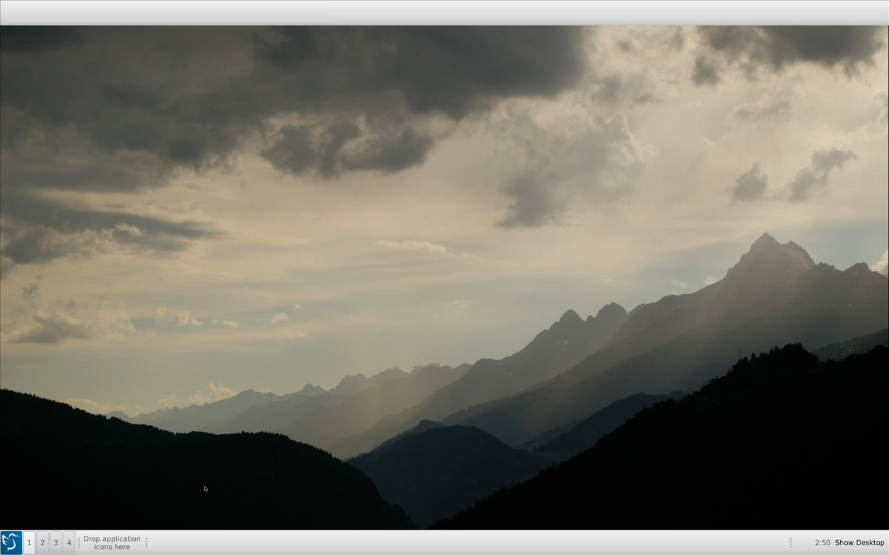
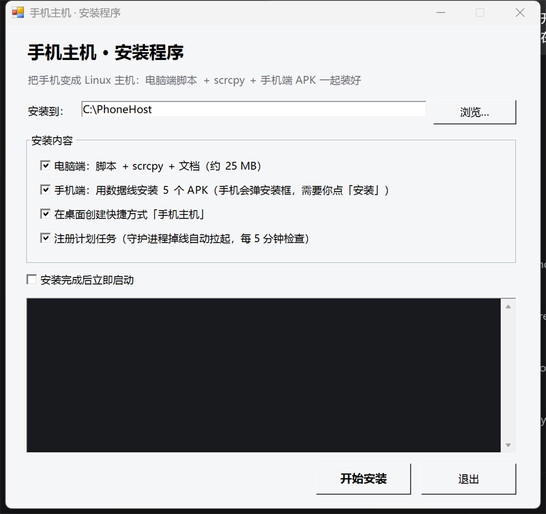

# 手机主机 · PhoneHost

> 把闲置的 Android 手机变成一台 **Linux 主机**：手机跑 Linux 桌面，电脑只当显示器 + 键鼠。


## 这是什么

一台吃灰的 Redmi K70 Pro，通过 **Termux + Termux:X11 + LXQt/XFCE** 跑真 Linux 桌面，
电脑端用 **scrcpy** 把画面（虚拟屏）投出来，手机屏幕熄灭、零发光、防烧屏。

```
┌──────────── 手机（Android）────────────┐        ┌──────── 电脑（Windows）────────┐
│  Termux  ──►  termux-x11  ──►  LXQt     │  USB   │  scrcpy  虚拟屏 2560x1600       │
│   (Linux 用户空间)                       │ ─────► │  ↑ 键鼠 / 手柄 直通              │
│  电池/温度守护 · 通知回传                │        │  控制台 + 托盘 + 自动重连        │
└─────────────────────────────────────────┘        └─────────────────────────────────┘
```

## 特性

| 特性 | 说明 |
|---|---|
| **真 Linux** | Termux 里跑 LXQt / XFCE，不是模拟器，性能接近原生 |
| **虚拟屏** | 电脑端建一块独立屏幕，手机主屏不受影响 |
| **防烧屏** | 工作负载在虚拟屏上时，物理面板可断电（面板 OFF，投屏照常） |
| **插拔自愈** | 拔线吃饭、插回来自动恢复上次模式 |
| **黑屏自愈** | 检测投屏画面亮度，黑屏先「只重画」再「重启会话」 |
| **手机端启动器** | 手机 Termux 里一个 TUI 菜单：开桌面 / 自检 / 权限跳转 |
| **通知回传** | Android 通知推到 Linux 桌面 |
| **温控调度** | 温度 ≥60℃ 降优先级，≥72℃ 暂停桌面保护手机 |
| **手柄直通** | `--gamepad=uhid` 把电脑手柄当物理手柄 |

## 截图



*手机跑 LXQt，投到电脑全屏：底部是面板（开始菜单 / 虚拟桌面 1-4 / 任务栏 / 时钟），物理屏幕可以熄灭*



*图形安装器：选安装目录、勾选组件、用数据线一键装手机端 APK*

## 两种安装方式

### 方式一：一键安装包（推荐，不用命令行）

直接下这个，**已经打包好 scrcpy 和 5 个 APK**：

**[⬇ PhoneHost-v1.0.0-installer.zip](https://github.com/MAKINA-WAX/phone-host/releases/latest)** · 65 MB

```
解压 → 双击「安装.bat」→ 选安装目录 → 数据线连手机 → 点「开始安装」
```

安装器会做：
- 复制电脑端脚本 + scrcpy 到**你选的目录**（默认 `C:\PhoneHost`，可改）
- 通过数据线给手机装 5 个 APK（手机上逐个点「继续安装」）
- 创建桌面快捷方式、注册计划任务
- 附带图形**卸载器**（程序文件 / 快捷方式 / 计划任务 / 手机 APK 一键卸）

### 方式二：从源码跑

```powershell
git clone https://github.com/MAKINA-WAX/phone-host.git
cd phone-host
powershell -ExecutionPolicy Bypass -File assets\download-assets.ps1   # 拉 scrcpy + APK
cd pc-mode
.\启动.bat        # 控制台：② 开画布 → ③ 开 Linux
```

详细步骤见 [docs/安装与使用.md](docs/安装与使用.md)。

## 目录结构

```
pc-mode/                 电脑端脚本（PowerShell + bat）
├─ 启动.bat              总入口
├─ pc-launcher.ps1       控制台 UI（11 个按钮）
├─ auto-start.ps1        建虚拟屏（自适应分辨率，默认 2K 16:10）
├─ start-lxqt.ps1        LXQt 桌面
├─ start-xfce.ps1        XFCE 桌面
├─ mirror-phone.ps1      手机镜像（全屏 / 窗口）
├─ game-vd.ps1           游戏 + 熄屏（防烧屏）
├─ anti-burn.ps1         熄屏 / 唤醒
├─ watch-reconnect.ps1   守护：插拔自愈 + 黑屏自愈 + 手机请求
├─ desktop-scale.ps1     桌面缩放（改 Xft.dpi）
└─ phone/                手机端脚本（bash）
   ├─ start-lxqt.sh      起 LXQt（openbox + 面板 + 桌面）
   ├─ start-xfce.sh      起 XFCE
   ├─ host-mode.sh       模式仲裁 + 温度调度（开机自启）
   ├─ notify-bridge.sh   通知回传
   └─ launcher.sh        手机端 TUI 启动器
docs/                    文档
assets/                  资源下载脚本（scrcpy / APK 不入库）
```

## 需要自己下载的东西

仓库**不包含**二进制文件（scrcpy、APK），两种方式拿：

- **想省事**：直接下 [Release 里的安装包](https://github.com/MAKINA-WAX/phone-host/releases/latest)，里面都有
- **从源码跑**：

```powershell
powershell -ExecutionPolicy Bypass -File assets\download-assets.ps1
```

会下载：
- [scrcpy](https://github.com/Genymobile/scrcpy)（投屏工具，GPL-3.0）
- Termux / Termux:X11 / Termux:API / Termux:Boot / Termux:Widget（F-Droid 版）

## 环境要求

| 端 | 要求 |
|---|---|
| 手机 | Android 11+，能装 Termux（本项目在 Redmi K70 Pro / HyperOS 验证） |
| 电脑 | Windows 10/11，PowerShell 5.1 |
| 线 | USB 数据线（能传数据的，非纯充电线） |

## 核心原理（几句话）

1. **Termux** 提供 Linux 用户空间（非 proot，性能最好）
2. **termux-x11** 起一个 X 服务器，**Termux:X11** 是它的显示客户端
3. 电脑端用 `scrcpy --new-display` 建**虚拟屏**，把 Termux:X11 铺上去
4. 因为虚拟屏独立于物理屏，所以**熄屏不影响画面**（防烧屏的由来）
5. 输入走 `--mouse=sdk`（真触摸注入）/ `--keyboard=uhid` / `--gamepad=uhid`

## 已知限制

- **MIUI 会杀后台**：需要在手机上手动设「省电无限制 / 自启动 / 最近任务锁定」
- **adb 权限**：部分功能（真触摸点击、读通知）需要开「USB 调试（安全设置）」
- **手柄**：部分第三方 2.4G 手柄 scrcpy 识别不到（SDL 问题），推荐蓝牙手柄
- **手机镜像**模式下熄屏会黑（镜像的就是物理屏），防烧屏只对虚拟屏有效

## 许可

本项目代码 [MIT](LICENSE)。
依赖的 scrcpy 为 GPL-3.0，Termux 系列为 GPL-3.0 / Apache-2.0，均不在本仓库内分发。

## 致谢

- [scrcpy](https://github.com/Genymobile/scrcpy) — 整个方案的基石
- [Termux](https://termux.dev/) / [Termux:X11](https://github.com/termux/termux-x11)
- LXQt / XFCE / openbox
